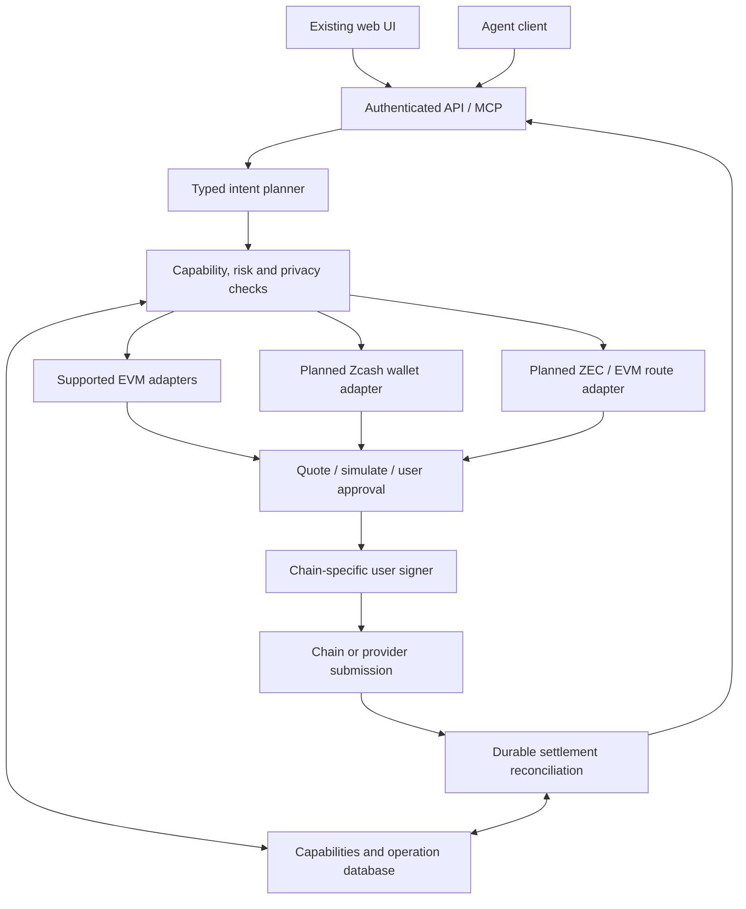
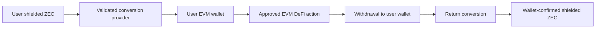

# ./AGENT EVM and Zcash architecture

Status: architecture proposal updated 2026-09-20. Current scope: supported EVM networks and tools, plus a planned Zcash gateway.
No Zcash integration is deployed by this document or the frontend copy update.

## 1. Product and scope

./AGENT is an agent-facing EVM DeFi toolkit building toward a Zcash gateway, not a new blockchain or custody bridge.

- Preserve the supported EVM wallet, swap, bridge, lending, staking, and data tools.
- Automation tools, standalone discovery/data tools, DAO voting, checkout, and paid plans have been removed.
- Add shielded Zcash wallet/payment support and ZEC-to-EVM conversion only after route and wallet validation.
- No additional chain or confidentiality-layer integration is in scope.
- Cross-chain provider selection is unresolved. Existing EVM bridge adapters must not be assumed to support Zcash.
- Use established infrastructure instead of issuing wrapped ZEC or deploying a pooled custody bridge.
- Separate agent planning, policy, transaction preparation, user approval, signing and settlement.
- Existing managed EVM wallets are a distinct custody mode. The proposed gateway defaults to user-controlled signing.
- Zcash shielding does not make EVM transactions or DeFi positions private.

## 2. Current system: source-grounded inventory

### Entry points and shared infrastructure

| Layer | Current files | Responsibility and limitations |
|---|---|---|
| Web application | src/client; Vite; vercel.json | Landing, toolkit, documentation, dashboard. Frontend deployment does not deploy the persistent MCP runtime. |
| Web/API proxy | src/server/index.ts | Hono SPA/API server; proxies selected auth, dashboard and A2A routes to MCP upstream. |
| Local agent interface | src/mcp/server.ts | MCP stdio. Runs in the local operator's trust boundary. |
| Hosted agent/API interface | src/mcp/serve.ts | Express; Streamable HTTP and legacy SSE; dashboard/auth/access/A2A endpoints; no automation worker starts. |
| Tool registry | src/mcp/tools/index.ts | Account-scoped tool dispatch, activity and memory hooks. The action catalog below reflects the remaining built-in modules. |
| EVM connectivity | src/mcp/chains.ts | 10 network configurations and viem clients. A network entry is not proof that every tool supports it. |
| Keys and transactions | wallet.ts, wallet-vault.ts, crypto.ts, tx-executor.ts | Encrypted managed EVM wallet storage and signing. Some adapters sign directly instead of using the common executor. |
| Controls | access-control.ts, spending-guard.ts, production-readiness.ts | Authentication/access, spending checks and runtime gates. Not evidence of universal enforcement across every action. |
| Legacy history | scheduler.ts and archived automation support modules | Persisted historical records remain readable; no public creation or execution worker. |
| Agent services | a2a.ts, memory.ts, activity-log.ts, skill-loader.ts | Task coordination, memory/history and dynamically imported tools. |
| Account services | access-store.ts, access-control.ts, payment-tracker.ts | Account authentication and API-key access; historical payment records retained without checkout or paid-plan enrollment. |

Only an underscore-prefixed example and README were found in src/mcp/skills. The loader skips underscore-prefixed files; no additional active plugin tools were identified from this directory. Runtime installations elsewhere or production settings were not inspected.

### All current EVM registry entries

| Network key | Network | Architectural role / current caveat |
|---|---|---|
| ethereum | Ethereum | Broadest configured DeFi coverage; public execution unless a separate confidential adapter is used. |
| arbitrum | Arbitrum | EVM wallet/routes; Aave configured; selected data/market integrations. |
| base | Base | Default wallet and subscription payment network; EVM routes and Aave configured. Other protocol support must be verified per deployment. |
| optimism | Optimism | EVM wallet/routes; Aave configured. |
| polygon | Polygon | EVM wallet/routes; Aave configured. |
| avalanche | Avalanche C-Chain | EVM wallet/routes; Aave configured. |
| abstract | Abstract | EVM client entry; does not appear in the bridge module's static chain-ID map. |
| bsc | BNB Chain | EVM wallet/routes and selected DEX configuration. |
| linea | Linea | EVM wallet/routes; no blanket lending support implied. |
| zksync | zkSync Era | EVM wallet/routes; zero-knowledge scaling is not default transaction privacy. |

Bridge module map: Ethereum, Arbitrum, Base, Optimism, Polygon, Avalanche, BNB Chain, Linea, and zkSync Era. Abstract is not automatically available through this map. Surviving route adapters are Jumper/LiFi and Relay; route availability must still be verified for each request.

Checkout and paid plans are removed. API keys and connector tokens remain required for authenticated account access.

### Important differences between advertised actions and executable support

- Direct Uniswap/PancakeSwap writes are explicitly disabled in swaps.ts. Their schemas still advertise swap actions.
- Aave has pool entries for Ethereum, Arbitrum, Base, Optimism, Polygon and Avalanche. The schema exposes supply/withdraw/positions, not borrow/repay.
- Morpho accepts a chain argument, but named vault constants and position reads are Ethereum-oriented. Do not advertise those names as verified Base deployments.
- Pendle market discovery selects Ethereum/Arbitrum/Base; the inspected purchase path uses Ethereum. Its positions action provides guidance rather than full position accounting.
- Lido deposits have a transaction path; its withdrawal action provides instructions, not a completed withdrawal lifecycle.
- Ethena mint and Ondo mint/redeem return eligibility/onboarding guidance. Some guidance points to direct swaps that are currently disabled.
- Automation startup and controls are removed; saved history is retained.
- Subscription payments use on-chain ERC-20 receipt verification. Tool calls use account access rather than per-call settlement.
- Current persistence requires single-instance operation; production-readiness.ts rejects configurations without that acknowledgement.
- The registry's write classification uses hand-maintained tool/action sets. It must not become the sole security boundary, especially for plugins, safety actions and alternate execution paths.
- Runtime skill installation fetches and imports code. Hosted production must treat it as privileged code deployment, not an ordinary untrusted agent action.

These are architecture observations, not an exhaustive security audit or a claim that remaining actions are production verified.

## 3. Target architecture

Control-flow arrows do not imply pooled custody. Start with a modular TypeScript service and durable worker, not separate microservices for every chain.

## 4. Adapter and signing boundaries

### EVM protocols

Retain supported adapters, but publish capabilities per tool/action/network. A configured RPC does not imply a protocol deployment or production-ready transaction path.

Current wallets are signed by the MCP host. Hosted managed-wallet users must understand that operator trust boundary. The proposed gateway builds unsigned, validated transactions for a connected user wallet; it does not silently reuse server-managed keys.

### Zcash

Planned responsibilities: network/address validation, wallet connection, payment preparation, local signing/proving, shielded receive confirmation and transaction status.

Choose and validate an actual wallet connector before claiming automated support. A manual deposit request is a separate UX, not a full wallet integration.
Validate the actual receiver selected from a Unified Address. Never silently replace a shielded destination with a transparent one.
Keep spending keys and full viewing keys off the hosted API and out of model prompts by default. Viewing keys reveal sensitive history even though they cannot spend.
Distinguish provider settlement from shielded receipt confirmed by the user's wallet.

### ZEC / EVM conversion provider

Provider remains unselected. An acceptable adapter must validate supported assets/networks, source deposit type, destination receiver, refund address, fees, minimum output, expiry and order status.
Require documented trust assumptions, access conditions and tested refund/recovery paths before enabling execution.
Do not route through an undeclared intermediary to imply that this scope is already implemented.

## 5. Funds flow and privacy

Every arrow is a separate step, not an atomic transaction. Selling ZEC into USDC changes price exposure; this is not yield on native ZEC.

| Stage | Privacy boundary |
|---|---|
| Shielded Zcash | Shielded transaction details are protected under Zcash's assumptions; wallet/network metadata still matters. |
| Conversion | Provider can know the route; transparent deposits, amounts and timing can expose correlations. |
| EVM wallet | Address, assets, transfers and gas funding are public. |
| EVM DeFi | Ordinary positions and contract interactions remain public. |
| Return to Zcash | Shielding does not erase earlier public EVM history. |
| ./AGENT | Account, quote, destination and order metadata can identify a journey unless deliberately minimized. |

Track sender, recipient, amount, position, route-linkage and network-metadata exposure separately. Unknown does not mean private. Reject requests whose privacy requirements cannot be met; no numeric privacy scores or claims of end-to-end anonymity.

## 6. Shared execution and authorization

Lifecycle: discover -> quote/prepare -> policy -> simulate -> review -> sign -> submit -> reconcile.

Each capability records tool/action, network/venue, production/testnet, read/write/admin classification, supported assets, verified contracts, signer, status, fees, simulation limitations, privacy disclosures and exit/refund support.
Statuses distinguish preview-only, disabled, implemented, integration-tested and production-approved. Publish the same catalog to UI, MCP and planner.

Bind approval to the canonical plan hash, chain, sender, recipient, asset, amount bounds, calldata/intent, fees, expiry and refund destination.
Material changes require reapproval. A chat prompt alone is not signing authorization.
The model proposes intent; deterministic code enforces policy. Provider responses, token metadata and social content are untrusted data.

Ask-first is the gateway default. Later automation needs expiring, revocable, explicitly scoped mandates supported by the chosen wallet.
All entry points, including A2A, automation and plugins, must pass the same enforcement boundary. Runtime code installation is an admin deployment operation, not a normal agent permission.

## 7. Durable state and failure recovery

Parent operations contain individual steps:
DRAFT -> QUOTED -> AWAITING_APPROVAL -> AWAITING_SIGNATURE -> SUBMITTED -> CONFIRMING -> SETTLED.

Branches: EXPIRED, REJECTED, FAILED, UNKNOWN_SUBMISSION, PARTIALLY_COMPLETED, REFUND_PENDING, REFUNDED and NEEDS_USER_ACTION.

Persist owner, quote/order/transaction IDs, plan hash, integer-string atomic amounts, asset/network identity, expiry, confirmations and recovery instructions.
Use transactional state changes, idempotency keys and per-wallet nonce coordination. Reconcile existing submissions after a timeout before requesting another signature.
Provider success is not proof of destination receipt. Track source finality, provider settlement and destination confirmation separately.
Reorgs pause dependent steps. Worker restarts resume from durable state.

| Failure | Handling |
|---|---|
| Expired quote | Requote and reapprove; do not blindly fund the old deposit address. |
| Deposit sent, provider times out | Reconcile the existing order; never automatically pay again. |
| Swap settles, DeFi call fails | Funds remain in the user wallet; offer retry, hold or return. |
| Destination lacks gas | Check before funding; require approved gas provisioning and exit reserve. |
| Withdrawal queues / lacks liquidity | Track pending and claimable states; do not promise instant exit. |
| Shielded return unsupported | Reject; no transparent fallback without explicit consent. |
| Refund pending | Track and verify actual receipt; do not promise immediate recovery. |
| Emergency pause | Stop new submissions while continuing settlement/refund monitoring. |

## 8. Data and deployment

- Vercel hosts the existing React frontend and short-lived proxy functions.
- A persistent Node API/MCP service handles authenticated coordination.
- A durable worker reconciles settlement, positions and approved automations.
- PostgreSQL stores operations, capabilities, approvals and jobs; a database-backed queue is sufficient initially.
- User devices hold gateway signing keys and perform wallet-specific Zcash proving/scanning.
- External dependencies include RPC/indexers, approved route providers, venues, market data and business services.

API and worker may initially share one deployment. Existing encrypted file stores require single-instance operation; migrate shared state before horizontal scaling.
Keep private keys out of frontend builds and hosted gateway storage. Separate identity and execution records with least-privilege access.
Encrypt sensitive records/backups and define retention/deletion policy. Do not log spending/viewing keys, wallet backups, memos or full transaction payloads.
Privacy-sensitive actions should not automatically enter agent memory, telemetry or model context. Existing memory hooks must be reviewed before gateway release.

Monitor pending age, provider outages, confirmation lag and recovery success using minimal metadata. Test backup restoration and service restart recovery.

## 9. Rollout and release gates

1. Inventory and capability enforcement across every current tool and entry point.
2. User signing, transaction-bound approval and durable operation lifecycle.
3. Zcash wallet integration and provider selection.
4. One ZEC / EVM round trip, including expired quotes, refunds, gas and shielded receipt.
5. One fully verified EVM DeFi deposit and withdrawal journey.
6. Expand across approved current EVM networks and tools, then scoped automation.

Required tests: cross-user isolation, hostile quote responses, address/network mismatch, decimals/slippage, approvals, reverts, duplicate submissions, restart/reorg handling, provider outage, privacy downgrade rejection and refund/exit completion.
Require external security review before significant capital. Do not label current registered tool names as production certification.

## 10. Open implementation decisions

- First EVM asset/network and first complete DeFi deposit/exit adapter.
- Compatible Zcash wallet and signing/proving interface.
- Conversion provider with validated shielded receive and refund paths.
- Legacy managed-wallet coexistence and explicit custody disclosures.
- Backend hosting, retention, incident response and provider eligibility requirements.

## Appendix A. Complete built-in tool/action catalog

Extracted statically from the imported modules in src/mcp/tools/index.ts. Registered tool names are not independently verified production integrations. The action list is schema coverage; the limitations above override names that suggest execution. Read-only inspection did not import or execute application tool handlers.

| Module | Tool | Declared actions |
|---|---|---|
| wallet | `wallet` | create, list, switch, rename, delete, recover_legacy, backup_export, backup_import, info, balance, send |
| wallet | `payment` | send, status |
| market-data | `market_data` | price, prices, chart, gas |
| defi | `aave` | supply, withdraw, positions |
| defi | `yield` | scan, stake_eth |
| analytics | `analytics` | portfolio, whale_activity, token_security, sentiment, resolve_ens |
| safety | `safety` | revoke_approvals, set_spending_limit, view_limits, remove_limits, reset_spent, simulate_tx, liquidations, export_history |
| advanced | `advanced` | swap_any_chain, backtest |
| protocols | `lido` | stake, withdraw, positions |
| protocols | `ethena` | mint, stake, positions |
| lending | `morpho` | supply, withdraw, positions |
| lending | `pendle` | buy_pt, buy_yt, positions, markets |
| lending | `ondo` | mint, redeem, positions |
| swaps | `uniswap` | swap, quote, pools, lp |
| swaps | `pancakeswap` | swap, quote |
| bridges | `jumper` | swap, quote, routes |
| bridges | `relay` | bridge, quote |
| wallet-send | `wallet_send` | quote, send, status |
| smart-swap | `smart_swap` | find_and_swap, find_best |
| account | `account` | me, create_api_key, revoke_api_key |
| memory | `memory` | remember, recall, history, forget, bulk_forget, list, stats, flush |
| skill-manager | `skill_manager` | install, list, remove, reload |
